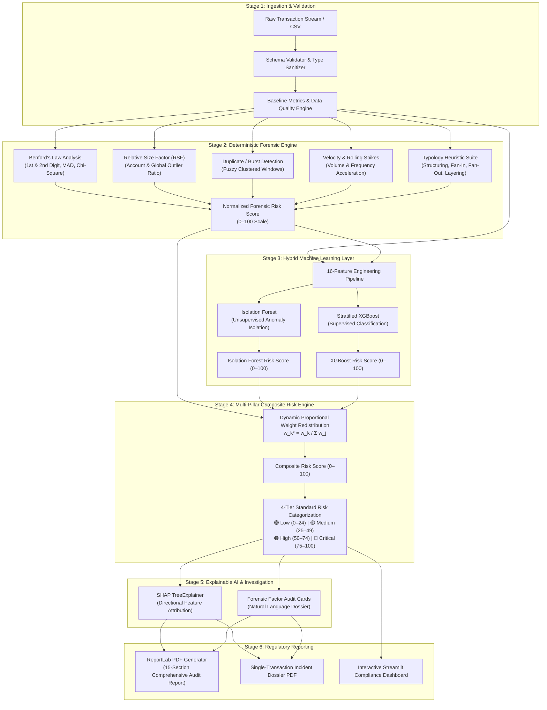

# Transaction Monitoring & Risk Scoring for Money Laundering Detection

Developed as part of the course on "Forensic Analytics" at Vellore Institute of Technology, Chennai.

by Dinesh Kumar J B (23MIA1126), Sanjay K (23MIA1060), Bharath (23MIA1059)

Subject Code: CSE4074

Semester: Fall 2026-27

Professor: Dr. S. Johanan Joysingh

---

[](https://www.python.org/)
[](https://streamlit.io/)
[](https://xgboost.readthedocs.io/)
[](https://scikit-learn.org/)
[](https://shap.readthedocs.io/)
[](https://www.reportlab.com/)
[](https://chennai.vit.ac.in/)
[]()

---

## 📌 Executive Summary & Abstract

Financial crime compliance and Anti-Money Laundering (AML) transaction monitoring systems face persistent operational bottlenecks: traditional rule-based threshold systems suffer from **false-positive rates exceeding 90–95%**, while purely "black-box" machine learning algorithms lack regulatory auditability and legal defensibility.

This project delivers an **end-to-end, multi-pillar Forensic Analytics and Machine Learning Transaction Monitoring System** engineered to detect illicit financial networks, anomalous payment patterns, and deliberate avoidance strategies. The system synthesizes:
1. **Classical Financial Forensic Auditing** (Benford's Law 1st & 2nd Digit tests, Relative Size Factor, Temporal Velocity, Duplicate Cluster Detection, Typology Heuristics).
2. **Dual-Model Machine Learning Detection** (Unsupervised Isolation Forest for zero-day typology isolation + Supervised Stratified XGBoost with genuine holdout evaluation).
3. **Normalized Multi-Pillar Composite Risk Scoring (0–100)** with dynamic **Proportional Weight Redistribution** to guarantee mathematical integrity without label hallucination.
4. **Explainable AI (SHAP TreeExplainer & Local Forensic Attribution)** to generate legally defensible auditor dossiers and directional risk vectors.
5. **Automated Regulatory PDF Audit Generation** (ReportLab two-pass `NumberedCanvas` engine) exporting 15-section institutional compliance dossiers.

---

## 🏛️ System Architecture



---

## 🔬 Core Methodological Stages

### Stage 1: Data Ingestion & Sanitization Pipeline
- **Validation:** Enforces strict required columns (`transaction_id`, `timestamp`, `sender_account`, `receiver_account`, `amount`).
- **Sanitization:** Coerces timestamps into ISO 8601 UTC datetimes, casts transaction amounts to double-precision non-negative floats, and handles missing or corrupted identifiers without pipeline failure.
- **Summary Generation:** Aggregates dataset statistics, transaction count, sender/receiver network cardinality, total dollar volume, and missing value indicators.

---

### Stage 2: Classical Forensic Auditing Suite

The forensic suite implements established statistical auditing and forensic accounting principles formulated by Dr. Mark Nigrini and the Financial Action Task Force (FATF).

#### 1. Benford's Law (First & Second Significant Digit)
Tests whether the distribution of leading digits follows the logarithmic natural distribution:
- **First Digit Probability:**
  $$P(d_1 = d) = \log_{10}\left(1 + \frac{1}{d}\right), \quad d \in \{1, 2, \dots, 9\}$$
- **Second Digit Probability:**
  $$P(d_2 = k) = \sum_{d_1=1}^9 \log_{10}\left(1 + \frac{1}{10 d_1 + k}\right), \quad k \in \{0, 1, \dots, 9\}$$
- **Goodness-of-Fit Testing:**
  - **Mean Absolute Deviation (MAD):**
    $$\text{MAD} = \frac{1}{K}\sum_{i=1}^K |O_i - E_i|$$
    *Conformity Thresholds:* Close conformity ($\text{MAD} < 0.006$), Acceptable conformity ($0.006 \le \text{MAD} < 0.012$), Nonconformity ($\text{MAD} \ge 0.015$).
  - **Pearson's Chi-Square Test ($\chi^2$):**
    $$\chi^2 = \sum_{i=1}^K \frac{(O_i - E_i)^2}{E_i}, \quad \text{dof} = K - 1$$

#### 2. Relative Size Factor (RSF)
Detects transaction amounts that are disproportionately large relative to the normal spending pattern of an account:
$$\text{RSF}_i = \frac{x_i^{(\max)}}{x_i^{(2\text{nd}\max)}}$$
Where $x_i^{(\max)}$ is the largest transaction for account $i$, and $x_i^{(2\text{nd}\max)}$ is the second-largest transaction. RSF values exceeding $5.0$ indicate high-risk anomalies, and values exceeding $10.0$ trigger critical escalation.

#### 3. Duplicate Transaction & Split Detector
Flags repeated transactions having identical dollar values originating from the same sender within narrow temporal windows ($\Delta t \le 24$ hours), a signature of split transactions or smurfing.

#### 4. Transaction Velocity & Burst Engine
Measures high-frequency bursts by calculating rolling transaction frequency and volume spikes:
$$\text{Velocity Ratio} = \frac{\text{Count}_{t \in [t_0, t_0 + \Delta t]}}{\mu_{\text{daily}}}$$
Accounts exhibiting velocity ratios $> 3.5\times$ above baseline are flagged for burst laundering.

#### 5. AML Typology Heuristic Engine
- **Structuring / Smurfing:** Detects transaction amounts just below the statutory reporting threshold ($10,000 threshold with detection window $[\$8,800, \$9,999.99]$).
- **Fan-In (Consolidation):** Flags multiple senders ($\ge 3$) sending funds to a single receiver within a short interval.
- **Fan-Out (Dispersal):** Flags a single sender distributing funds rapidly across multiple disparate receivers ($\ge 3$).
- **Layering (Rapid Pass-Through):** Identifies intermediary "mule" accounts where inflow and outflow volumes balance within 10% within a 48-hour transit window.

---

### Stage 3: Hybrid Machine Learning Detection Layer

#### 16-Dimensional Feature Engineering Pipeline
Combines raw transaction properties, historical account behavioral baselines, and deterministic forensic risk signals:
1. `amount`
2. `log_amount` ($\ln(\text{amount} + 1)$)
3. `hour_of_day`
4. `day_of_week`
5. `is_weekend`
6. `sender_total_tx_count`
7. `sender_total_amount`
8. `sender_mean_amount`
9. `sender_std_amount`
10. `sender_max_amount`
11. `amount_to_sender_mean_ratio`
12. `receiver_total_tx_count`
13. `receiver_total_amount`
14. `rsf_score`
15. `velocity_count`
16. `is_structuring_flag`

#### Unsupervised Anomaly Isolation: Isolation Forest
Partitions high-dimensional feature space using recursive random decision trees. Path length $h(x)$ to isolate a point $x$ inversely correlates with anomalousness:
$$s(x, n) = 2^{-\frac{\mathbb{E}(h(x))}{c(n)}}$$
where the average path length of unsuccessful searches in a Binary Search Tree is:
$$c(n) = 2\left(\ln(n - 1) + 0.5772156649\right) - \frac{2(n-1)}{n}$$
The raw anomaly score is linearly rescaled to a normalized risk metric: $S_{\text{IF}} \in [0, 100]$.

#### Supervised Classification: Stratified XGBoost
Gradient boosted decision trees trained on ground-truth laundering labels with a 75/25 stratified holdout split:
$$\mathcal{L}^{(t)} = \sum_{i=1}^N \ell\left(y_i, \hat{y}_i^{(t-1)} + f_t(x_i)\right) + \gamma T + \frac{1}{2}\lambda \sum_{j=1}^T w_j^2$$
Evaluated with ROC-AUC, Precision, Recall, and F1-Score. The calibrated probability is rescaled to $S_{\text{XGB}} = P(\text{Laundering}) \times 100$.

---

### Stage 4: Multi-Pillar Composite Risk Scoring Engine

To eliminate siloing between heuristic rules and machine learning, the system synthesizes all signals into a **unified Composite Risk Score (0–100)**.

#### Mathematical Formulation & Proportional Redistribution
Let $\mathcal{K} = \{\text{Forensic}, \text{IsolationForest}, \text{XGBoost}\}$ represent the component signals with baseline target weights:
$$w_{\text{forensic}} = 0.40, \quad w_{\text{iso\_forest}} = 0.30, \quad w_{\text{xgboost}} = 0.30$$

Let $\mathcal{A} \subseteq \mathcal{K}$ represent the active signals available in the dataset. When ground truth is absent (e.g., unlabeled customer CSV), supervised models cannot run honestly. **Rather than fabricating artificial labels**, the engine dynamically redistributes weights proportionally:
$$w_k^* = \frac{w_k}{\sum_{j \in \mathcal{A}} w_j}, \quad \forall k \in \mathcal{A}$$

$$\sum_{k \in \mathcal{A}} w_k^* = 1.0$$

When XGBoost is inactive:
$$w_{\text{forensic}}^* = \frac{0.40}{0.40 + 0.30} = \frac{0.40}{0.70} \approx 57.14\%$$
$$w_{\text{iso\_forest}}^* = \frac{0.30}{0.40 + 0.30} = \frac{0.30}{0.70} \approx 42.86\%$$

The composite score is computed as:
$$S_{\text{composite}} = \sum_{k \in \mathcal{A}} w_k^* \cdot S_k, \quad S_{\text{composite}} \in [0, 100]$$

#### 4-Tier Standard Risk Classification
| Tier | Score Range | Color Code | Action Required |
|---|---|---|---|
| **Low Risk** | 0 – 24 | 🟢 Green | Routine STP (Straight-Through Processing) approval |
| **Medium Risk** | 25 – 49 | 🟡 Amber | Secondary automated rule check; periodic batch audit |
| **High Risk** | 50 – 74 | 🟠 Orange | Mandatory senior AML compliance analyst review within 48h |
| **Critical Risk** | 75 – 100 | 🔴 Red | Immediate payment hold; freeze account; expedited SAR filing |

---

### Stage 5: Explainable AI (XAI) & Audit Dossier Engine
- **SHAP (SHapley Additive exPlanations):** Calculates local Shapley values:
  $$\phi_i(f, x) = \sum_{S \subseteq F \setminus \{i\}} \frac{|S|!(|F| - |S| - 1)!}{|F|!} \left[f(S \cup \{i\}) - f(S)\right]$$
- **Directional Attribution:** Distinguishes risk-escalating factors ($\phi_i > 0$, e.g., high RSF ratio, near-threshold structuring) from risk-mitigating factors ($\phi_i < 0$, e.g., long account tenure, regular weekday activity).
- **Rule-Based Fallback:** If XGBoost is inactive, transparent deterministic forensic factor attribution provides the exact rules that fired.
- **Natural Language Incident Dossier:** Automatically synthesizes human-readable case notes for compliance officers.

---

### Stage 6: Automated Regulatory PDF Audit Generation
- **ReportLab Engine:** Two-pass `NumberedCanvas` renderer calculating dynamic page counts ("Page X of Y").
- **15-Section Comprehensive Audit Report:** Executive summary, Benford analysis charts, RSF tables, velocity histograms, typology breakdowns, ML benchmarking ROC curves, high-risk account profiles, and auditor signature sign-off.
- **Transaction Incident Dossier:** Single-page exportable PDF dossier for individual flagged transactions ready for legal submission to Financial Intelligence Units (FIUs).

---

## 🗂️ Project Directory Structure

```
AML_Forensic_Analytics_Project/
├── app.py                             # Main Streamlit forensic interactive application
├── requirements.txt                   # Production Python dependencies
├── README.md                          # Main project documentation & setup guide
├── PROJECT_PRESENTATION.md            # Slide-by-slide presentation deck (PPT equivalent)
├── PROJECT_PRESENTATION.html          # Interactive presentation deck web application
├── .gitignore                         # Git exclusion rules (including paper drafts)
├── data/
│   └── sample_transactions.csv        # Benchmark AML transaction dataset (218 verified records)
├── reports/
│   ├── generate_pdf_report.py         # Automated executive PDF inspection report generator
│   └── generate_ml_inspection_pdf.py  # Model inspection & ML validation PDF generator
├── tests/
│   ├── test_forensic_suite.py         # Automated unit & integration tests for Forensic Suite
│   ├── test_ml_suite.py               # Tests for Feature Engineering, Isolation Forest, XGBoost
│   ├── test_composite_risk.py         # Tests for Proportional Weight Redistribution & Tiers
│   ├── test_explainability.py         # Tests for SHAP TreeExplainer & Rule Attribution
│   └── test_reporting.py              # Tests for ReportLab PDF compilation & dossier generation
└── src/
    ├── __init__.py                    # Top-level src package
    ├── config.py                      # System configuration, risk boundaries & color palettes
    ├── utils/
    │   ├── __init__.py
    │   └── data_loader.py             # Schema validation, CSV loading & metrics extraction
    ├── forensic/                      # Classical Forensic Auditing Module
    │   ├── __init__.py
    │   ├── benford.py                 # Benford's Law (1st/2nd digit, MAD, Chi-Square)
    │   ├── rsf.py                     # Relative Size Factor calculation & scoring
    │   ├── duplicates.py              # Rapid duplicate and split transaction detection
    │   ├── velocity.py                # Rolling burst velocity and spike calculation
    │   ├── typologies.py              # Heuristics: Structuring, Fan-In, Fan-Out, Layering
    │   └── engine.py                  # Forensic suite coordinator & scorecard generator
    ├── ml/                            # Machine Learning Detection Module
    │   ├── __init__.py
    │   ├── feature_engineering.py     # 16-feature vector pipeline with account history
    │   ├── isolation_forest.py        # Unsupervised Isolation Forest anomaly scorer (0-100)
    │   ├── xgboost_model.py           # Supervised Stratified XGBoost classifier
    │   └── engine.py                  # ML pipeline coordinator & model comparison
    ├── scoring/                       # Composite Risk Scoring Module
    │   ├── __init__.py
    │   └── composite_risk.py          # Dynamic proportional redistribution & 4 risk tiers
    ├── explainability/                # Explainable AI (XAI) Module
    │   ├── __init__.py
    │   └── engine.py                  # SHAP TreeExplainer, attribution & compliance dossier
    ├── reporting/                     # Regulatory PDF Generation Module
    │   ├── __init__.py
    │   └── pdf_generator.py           # ReportLab 15-section audit report & transaction dossier
    └── typologies/                    # Typology definitions and schemas
        └── __init__.py
```

---

## 🛠️ Technology Stack & Dependencies

| Category | Component / Library | Version | Purpose |
|---|---|---|---|
| **Language** | Python | `>= 3.10` | Core programming language |
| **Web UI** | Streamlit | `>= 1.35.0` | Interactive forensic analyst dashboard |
| **Data Processing** | Pandas, NumPy | `>= 2.0.0`, `>= 1.24.0` | High-performance tabular transformation |
| **Statistical Analysis** | SciPy | `>= 1.12.0` | Chi-Square tests, p-value calculation |
| **Unsupervised ML** | Scikit-Learn | `>= 1.4.0` | Isolation Forest, Stratified K-Fold, Metrics |
| **Supervised ML** | XGBoost | `>= 2.0.0` | Gradient boosted decision trees |
| **Explainable AI** | SHAP | `>= 0.45.0` | TreeExplainer, Shapley value attribution |
| **Data Visualization** | Plotly, Matplotlib | `>= 5.20.0`, `>= 3.7.0` | Interactive charts, Benford curves, Histograms |
| **Document Generation**| ReportLab, PyPDF2 | `>= 4.0.0`, `>= 3.0.0` | Institutional PDF forensic reports |
| **Test Automation** | Pytest | `>= 7.4.0` | Unit, integration & regression test suites |

---

## 🚀 Installation & Setup Guide

### 1. Clone the Repository
```bash
git clone https://github.com/Dineshkumar-jb/AML_Forensic_Analytics_Project.git
cd AML_Forensic_Analytics_Project
```

### 2. Create and Activate Virtual Environment
```bash
# Linux / macOS
python3 -m venv venv
source venv/bin/activate

# Windows (Command Prompt / PowerShell)
python -m venv venv
.\venv\Scripts\activate
```

### 3. Install Dependencies
```bash
pip install --upgrade pip
pip install -r requirements.txt
```

### 4. Run the Automated Test Suite
Verify that all unit and integration tests pass:
```bash
pytest -v
```

Or run individual module test suites:
```bash
python -m pytest tests/test_forensic_suite.py -v
python -m pytest tests/test_ml_suite.py -v
python -m pytest tests/test_composite_risk.py -v
python -m pytest tests/test_explainability.py -v
python -m pytest tests/test_reporting.py -v
```

### 5. Launch the Streamlit Interactive Dashboard
```bash
streamlit run app.py
```
Open your web browser and navigate to `http://localhost:8501`.

---

## 🖥️ Presentation & Review Materials

In compliance with the Third Review deliverables:
- **Presentation Deck Document:** [`PROJECT_PRESENTATION.md`](PROJECT_PRESENTATION.md)  
  *Contains the comprehensive, slide-by-slide presentation deck with complete speaking notes, mathematical proofs, diagrams, and evaluation tables matching the PPT.*
- **Interactive Presentation Web App:** [`PROJECT_PRESENTATION.html`](PROJECT_PRESENTATION.html)  
  *A standalone presentation deck web application with keyboard slide navigation (`←` / `→`), modern financial dark UI, interactive metric cards, and presenter notes.*

---

## 🎓 Third Review Viva & Defense FAQ

#### Q1: Why combine deterministic forensic rules with machine learning into a composite score?
> **Answer:** In anti-money laundering compliance, neither rules nor ML can succeed independently:
> - **Heuristic Rules** (Benford's Law, RSF, Structuring) provide clear statutory compliance, explainability, and legal defensibility required by regulators (e.g., FinCEN, FATF). However, rules are rigid and easily circumvented by adaptive criminals.
> - **Machine Learning** (Isolation Forest, XGBoost) excels at detecting non-linear interactions and novel zero-day typologies. However, ML models often produce black-box scores that compliance officers cannot defend in court.
> - **Our Multi-Pillar Composite Engine** combines both: deterministic forensic rules anchor the base score (40%), while ML isolates subtle behavioral anomalies (30% IF + 30% XGB), producing a transparent 0–100 score.

#### Q2: What happens mathematically when an uploaded customer CSV does not contain ground truth labels?
> **Answer:** In real-world enterprise deployments, operational transaction streams are unlabeled. Rather than fabricating synthetic labels or generating pseudo-probabilities, the system activates **Dynamic Proportional Weight Redistribution**:
> $$w_k^* = \frac{w_k}{\sum_{j \in \mathcal{A}} w_j}$$
> The supervised XGBoost weight (30%) is eliminated, and its weight is proportionally redistributed between Forensics ($57.14\%$) and Isolation Forest ($42.86\%$), preserving a strict 0–100 scale without fabricating artificial predictions.

#### Q3: How is Benford's Law applied to transaction monitoring and what are its limitations?
> **Answer:** Benford's Law states that in naturally occurring multi-order numerical datasets, the probability of leading digit $d$ is $\log_{10}(1 + 1/d)$. Fraudulent actors who fabricate transaction amounts or deliberately structure amounts under thresholds (e.g., \$9,500, \$9,800) distort this logarithmic curve. We quantify this deviation using **Mean Absolute Deviation (MAD)** and **Chi-Square Goodness-of-Fit ($\chi^2$)**. Its limitation is that it applies to macro distributions spanning multiple orders of magnitude; single transactions are evaluated in conjunction with RSF and velocity metrics.

#### Q4: How does your system satisfy the "Right to Explanation" under regulatory frameworks?
> **Answer:** Under FATF guidelines and GDPR Article 22, automated risk scoring cannot be arbitrary. Our system integrates **SHAP (SHapley Additive exPlanations)** with TreeExplainer to compute exact additive feature attributions for every transaction. If a transaction receives a score of 82/100, the compliance officer is presented with directional vectors (e.g., `amount_to_sender_mean_ratio: +24.2`, `rsf_score: +18.5`, `is_structuring: +15.0`), accompanied by natural-language incident notes and exportable ReportLab PDF dossiers.

---

## 👥 Project Team & Course Information

- **Course:** CSE4074 – Forensic Analytics
- **Semester:** Fall 2026-27
- **Institution:** School of Computer Science and Engineering (SCOPE), Vellore Institute of Technology, Chennai
- **Faculty Guide / Professor:** Dr. S. Johanan Joysingh
- **Team Members:**
  - **Dinesh Kumar J B** — Register No: `23MIA1126`
  - **Sanjay K** — Register No: `23MIA1060`
  - **Bharath** — Register No: `23MIA1059`
